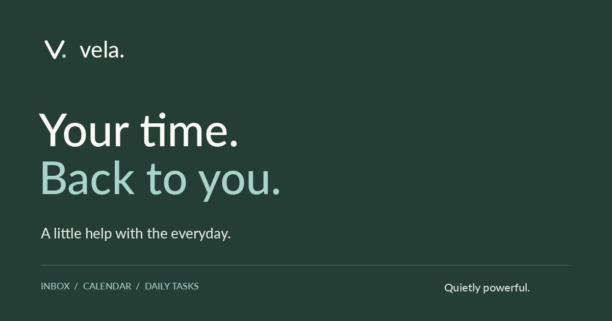

# Vela

> **Your time. Back to you.**

Vela is a concept landing page for a lightweight, local-first AI companion that quietly handles the everyday — inbox, calendar, and daily tasks.

The site was designed and built as the final project of the **Santander Academy AI Dive Intensive**, a hands-on crash course exploring an AI-assisted creative workflow from first sketch to shipped page.



---

## Overview

Vela imagines a calmer relationship with technology: less inbox noise, more breathing room in the calendar, and the small tasks already taken care of. The page pairs editorial typography and a warm, natural palette with interactive product previews and a short cinematic hero.

The project is a **front-end concept demo**. There is no backend, no accounts, and no data collection — the "Deploy Vela" form intentionally does not submit anything.

## Highlights

- **Cinematic hero** with a looping background video and poster fallback
- **Interactive capability previews** for Inbox, Calendar, and Daily Tasks, built as real React components rather than screenshots
- **Original soundtrack** with an accessible play / pause / replay control and a graceful fallback when autoplay is blocked
- **Native `<dialog>` deployment modal** with focus restoration and a clearly labelled demo state
- **Responsive navigation** with a mobile menu and skip link
- **Reduced-friction motion and audio** that respect browser policies and user opt-out

## Tech stack

| Layer      | Choice                                       |
| ---------- | -------------------------------------------- |
| UI         | React 19 + TypeScript                        |
| Build      | Vite 8                                       |
| Styling    | Tailwind CSS v4 + hand-authored CSS          |
| Typography | Manrope (Google Fonts)                       |
| Icons      | Inline SVG                                   |
| Audio      | HTML5 `<audio>`                              |
| Formatting | oxfmt                                        |

## Getting started

### Prerequisites

- Node.js 20 or newer
- pnpm (recommended) or npm

### Install and run

```bash
pnpm install
pnpm dev
```

The app is served at `http://localhost:5173` by default. Inside Figma Make, a development server is already provided on `$PORT` (default `8443`) and the preview panel updates automatically.

### Scripts

| Command        | Purpose                              |
| -------------- | ------------------------------------ |
| `pnpm dev`     | Start the Vite development server    |
| `pnpm build`   | Create a production build in `dist/` |
| `pnpm preview` | Preview the production build locally |
| `pnpm format`  | Format the project with oxfmt        |

## Project structure

```text
.
├── assets/                     # Source media (hero, service art, soundtrack)
├── public/                     # Static files served as-is (icons, social card, video)
├── src/
│   ├── App.tsx                 # Page layout, hero, navigation, modal, audio controls
│   ├── ServicePreview.tsx      # Interactive Inbox / Calendar / Tasks previews
│   ├── service-preview.css     # Styles scoped to the product previews
│   ├── index.css               # Tailwind import, global base styles, theme tokens
│   └── main.tsx                # React entry point
├── index.html                  # HTML shell with Figma Make metadata slots
├── vite.config.ts              # Vite, React, Tailwind, and Figma Make plugins
└── package.json
```

## How it was made

This project was an exercise in directing AI tools rather than writing every asset by hand:

| Stage           | Tool                                     |
| --------------- | ---------------------------------------- |
| Design          | **Figma** — layout, visual system, components |
| Content         | **Gemini Flow** — copywriting and narrative |
| Sound           | **Suno** — original soundtrack, "Dawn of a New Era" |
| Code & assembly | **Figma Make** + React, Vite, Tailwind CSS |
| Programme       | **Santander Academy AI Dive Intensive** — crash course |

The goal was to move from concept to a polished, responsive page within the constraints of an intensive course, using AI for design exploration, copy, and music while keeping the front-end implementation deliberate and accessible.

## Accessibility & behaviour notes

- Background music starts at low volume and falls back to interaction-based playback when a browser blocks autoplay. The sound control always takes priority over that fallback.
- The menu button exposes `aria-expanded`, and the modal restores focus to the element that opened it.
- Capability previews use `aria-pressed`, `aria-expanded`, and polite live regions for their interactive states.
- Focus styles, a skip link, and semantic landmarks are included throughout.

## Demo disclaimer

Vela is a fictional product created for educational and portfolio purposes. The email form is a demonstration and does not collect or transmit any information.

---

Built during the **Santander Academy AI Dive Intensive**.
